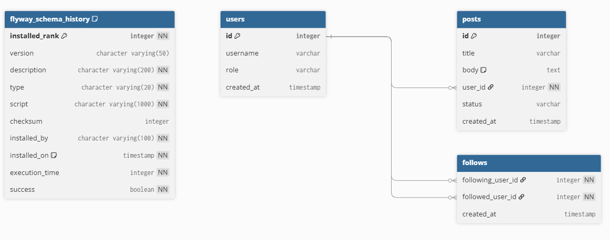
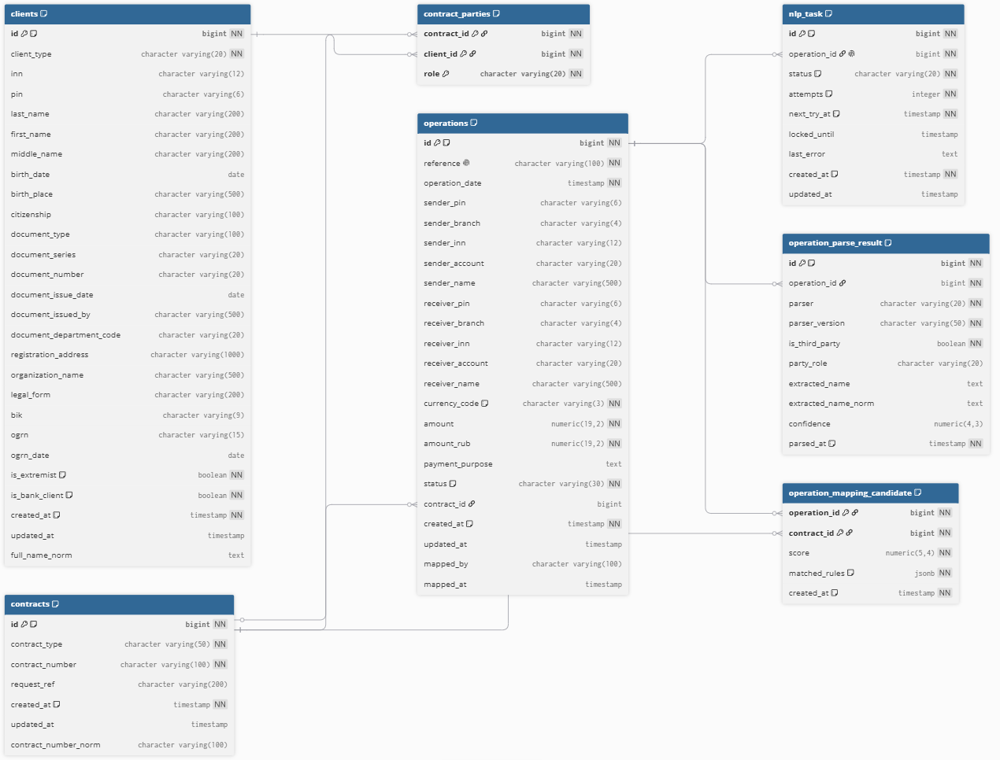

# AVP ITeam - Оптимизация системы автоматической привязки операций к договорам

Проект реализует MVP по привязке банковских операций к договорам
в рамках требований 115-ФЗ: модуль маппинга операций с договорами
по ИНН, модуль извлечения выгодоприобретателя из назначения платежа
(с двумя сравниваемыми подходами - алгоритмическим и NLP)

## Стек

- **Java 21**, Spring Boot 3.3.5
- **Vaadin 24 LTS** - UI
- **PostgreSQL 16** - основная БД
- **Flyway** - миграции схемы БД
- **Python 3.14+**, FastAPI, Natasha - NLP-сервис для гипотезы Б

## Текущая структура репозитория

```
avp_iteam/
├── backend/                 # Java/Spring Boot/Vaadin приложение
├── nlp-service/             # Python-микросервис (гипотеза NLP)
├── data/                    # Размеченный тестовый датасет
├── docs/                    # Аналитика, сравнение гипотез
├── docker-compose.yml       # Postgres для локальной разработки
└── README.md
```


## 1. Поднятие базы данных

Из корня репозитория:

```bash
docker-compose up -d
```

Проверка, что контейнер поднялся и БД готова принимать подключения:

```bash
docker ps
```
---

## 2. Запуск бэкенда

### Через IntelliJ IDEA

1. Откройте проект (`File → Open`, указать папку `backend/`, либо корень
   репозитория, если настроен как multi-module - см. примечание ниже)
2. Дождитесь, пока Maven подтянет зависимости (прогресс-бар внизу IDE)
3. Найдите класс `com.bank.avpiteam.AvpIteamApplication`
4. Запустите через зелёную стрелку слева от класса, либо `Run`

### Через терминал

```bash
cd backend
mvn spring-boot:run
```

При успешном старте в логах будет:

```
Flyway ... Successfully applied 2 migrations to schema "public"
...
Started AvpIteamApplication in X.XXX seconds
```

Приложение доступно на [http://localhost:8080](http://localhost:8080)

> **Важно:** при первом запуске таблицы ещё пустые. Для заполнения
> тестовыми данными - см. раздел ниже про профиль `datagen`

---

## 3. Генерация тестовых данных

Генератор заполняет БД клиентами, договорами и операциями. Запускается
только с профилем `datagen`, чтобы не плодить данные при обычном старте

**Через IntelliJ:**
`Run → Edit Configurations → Active profiles: datagen` → Run

**Через терминал:**
```bash
cd backend
mvn spring-boot:run -Dspring-boot.run.profiles=datagen
```

Количество генерируемых записей настраивается в
`application-datagen.yml`:

```yaml
datagen:
  clients-count: 10000
  contracts-count: 100000
  operations-count: 1000
```

Повторный запуск с этим профилем безопасен - генератор проверяет,
есть ли уже данные в БД, и пропускает генерацию, если таблицы не пусты

---

## 4. Бенчмарк гипотезы А (алгоритмический парсер, Java)

Сравнивает точность извлечения данных на размеченном датасете
(`data/test-dataset.csv`) и замеряет производительность

**Через IntelliJ:**
`Run → Edit Configurations → Active profiles: benchmark-a` → Run

**Через терминал:**
```bash
cd backend
mvn spring-boot:run -Dspring-boot.run.profiles=benchmark-a
```

Результат печатается в консоль двумя блоками: `Фаза 1` (точность)
и `Фаза 2` (производительность - throughput, CPU, память)

Путь к датасету и количество итераций нагрузочного теста настраиваются
в `application-benchmark-a.yml`

### Снятие метрик CPU/RAM

Во время `Фаза 2` есть пауза в 10 секунд - необходимо подключиться к процессу
через **JConsole** (идёт в комплекте с JDK, запускается командой `jconsole`
из терминала) или VisualVM. PID процесса выводится в лог перед паузой

---

## 5. Бенчмарк гипотезы Б (NLP-парсер, Python)

### Установка окружения (один раз)

```bash
cd nlp-service
python -m venv venv

# Активация:
# Windows:
venv\Scripts\activate
# macOS / Linux:
source venv/bin/activate

pip install -r requirements.txt
```

Установка займёт несколько минут - Natasha скачивает предобученные
embedding-модели.

### Запуск бенчмарка

```bash
# venv должен быть активирован
python benchmark/run_benchmark.py
```

Аналогично Java-версии - печатает точность и метрики производительности.
PID процесса выводится перед 10-секундной паузой для подключения
системного монитора (Диспетчер задач / Activity Monitor / htop).

## Схема БД

Миграции Flyway: `V1__init_schema.sql` (базовые таблицы),
`V2__mapping_schema.sql` (схема под маппинг и очередь NLP).

| Таблица | Назначение | Ключевые поля |
|---|---|---|
| `clients` | Клиенты банка (ФЛ, ИП, ЮЛ в одной таблице) | `inn` (nullable), `client_type`, `full_name_norm`, `is_bank_client` |
| `contracts` | Договоры | `contract_number`, `contract_number_norm`, `contract_type` |
| `contract_parties` | Стороны договора в ролях `COUNTERPARTY` / `AGENT` / `BENEFICIARY` | `contract_id`, `client_id`, `role` |
| `operations` | Операции (платежи) из АБС | `reference`, `sender_inn`, `receiver_inn`, `contract_id`, `status`, `mapped_by` |
| `operation_parse_result` | Результаты парсинга назначения платежа (маркерный и NLP) | `operation_id`, `parser`, `extracted_name_norm`, `party_role`, `confidence` |
| `operation_mapping_candidate` | Договоры-кандидаты для операции со скорингом | `operation_id`, `contract_id`, `score`, `matched_rules` |
| `nlp_task` | Очередь задач на NLP-разбор | `operation_id`, `status`, `attempts`, `next_try_at`, `locked_until` |
| `flyway_schema_history` | Служебная таблица миграций | - |

### Связи

- `contract_parties.contract_id → contracts.id`, `contract_parties.client_id → clients.id` - стороны договора;
  у договора может быть несколько сторон одной роли
- `operations.contract_id → contracts.id` - итоговый привязанный договор (nullable, заполняется модулем маппинга)
- `operation_parse_result.operation_id`, `operation_mapping_candidate.operation_id`, `nlp_task.operation_id → operations.id`
- `operation_mapping_candidate.contract_id → contracts.id`




### Нормализация для поиска

Вычисляются в БД (generated columns), в Java только читаются:

- `clients.full_name_norm` - `фамилия имя отчество` в нижнем регистре, `ё → е`, одиночные пробелы.
  По тому же правилу считается `operation_parse_result.extracted_name_norm`,
  поэтому ФИО из парсера сравнивается с клиентом простым равенством
- `contracts.contract_number_norm` - только буквы и цифры, верхний регистр, `Ё → Е`
  (`№ 110-кр` → `110КР`)

### Индексы для маппинга

Маппинг ищет в `clients` и `contract_parties`, а не в `operations`:

- `clients`: `inn`, `full_name_norm`
- `contract_parties`: `(client_id, role, contract_id)` - все договоры клиента одним индексным поиском
- `contracts`: `contract_number_norm`
- `operations`: частичный индекс по `id` для `status = 'PENDING'` - выборка пачками
- `nlp_task`: частичные индексы для готовых (`NEW`) и зависших (`IN_PROGRESS`) задач

---

## Документация по проведенному сравнению

- [`docs/hypothesis-results.md`](docs/hypothesis-result.md) - сравнение гипотез парсинга (точность, производительность, найденные ограничения)

