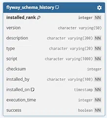

# AVP ITeam - Оптимизация системы автоматической привязки операций к договорам

Проект реализует MVP по привязке банковских операций к договорам
в рамках требований 115-ФЗ: модуль маппинга операций с договорами
по ИНН, модуль извлечения выгодоприобретателя из назначения платежа
(с двумя сравниваемыми подходами - алгоритмическим и NLP)

## Стек

- **Java 21**, Spring Boot 3.3.5
- **Vaadin 24 LTS** - UI
- **PostgreSQL 16** - основная БД
- **Flyway** - миграции схемы БД
- **Python 3.14+**, FastAPI, Natasha - NLP-сервис для гипотезы Б

## Текущая структура репозитория

```
avp_iteam/
├── backend/                 # Java/Spring Boot/Vaadin приложение
├── nlp-service/             # Python-микросервис (гипотеза NLP)
├── data/                    # Размеченный тестовый датасет
├── docs/                    # Аналитика, сравнение гипотез
├── docker-compose.yml       # Postgres для локальной разработки
└── README.md
```


## 1. Поднятие базы данных

Из корня репозитория:

```bash
docker-compose up -d
```

Проверка, что контейнер поднялся и БД готова принимать подключения:

```bash
docker ps
```
---

## 2. Запуск бэкенда

### Через IntelliJ IDEA

1. Откройте проект (`File → Open`, указать папку `backend/`, либо корень
   репозитория, если настроен как multi-module - см. примечание ниже)
2. Дождитесь, пока Maven подтянет зависимости (прогресс-бар внизу IDE)
3. Найдите класс `com.bank.avpiteam.AvpIteamApplication`
4. Запустите через зелёную стрелку слева от класса, либо `Run`

### Через терминал

```bash
cd backend
mvn spring-boot:run
```

При успешном старте в логах будет:

```
Flyway ... Successfully applied 1 migration to schema "public"
...
Started AvpIteamApplication in X.XXX seconds
```

Приложение доступно на [http://localhost:8080](http://localhost:8080)

> **Важно:** при первом запуске таблицы ещё пустые. Для заполнения
> тестовыми данными - см. раздел ниже про профиль `datagen`

---

## 3. Генерация тестовых данных

Генератор заполняет БД клиентами, договорами и операциями. Запускается
только с профилем `datagen`, чтобы не плодить данные при обычном старте

**Через IntelliJ:**
`Run → Edit Configurations → Active profiles: datagen` → Run

**Через терминал:**
```bash
cd backend
mvn spring-boot:run -Dspring-boot.run.profiles=datagen
```

Количество генерируемых записей настраивается в
`application-datagen.yml`:

```yaml
datagen:
  clients-count: 10000
  contracts-count: 100000
  operations-count: 1000
```

Повторный запуск с этим профилем безопасен - генератор проверяет,
есть ли уже данные в БД, и пропускает генерацию, если таблицы не пусты

---

## 4. Бенчмарк гипотезы А (алгоритмический парсер, Java)

Сравнивает точность извлечения данных на размеченном датасете
(`data/test-dataset.csv`) и замеряет производительность

**Через IntelliJ:**
`Run → Edit Configurations → Active profiles: benchmark-a` → Run

**Через терминал:**
```bash
cd backend
mvn spring-boot:run -Dspring-boot.run.profiles=benchmark-a
```

Результат печатается в консоль двумя блоками: `Фаза 1` (точность)
и `Фаза 2` (производительность - throughput, CPU, память)

Путь к датасету и количество итераций нагрузочного теста настраиваются
в `application-benchmark-a.yml`

### Снятие метрик CPU/RAM

Во время `Фаза 2` есть пауза в 10 секунд - необходимо подключиться к процессу
через **JConsole** (идёт в комплекте с JDK, запускается командой `jconsole`
из терминала) или VisualVM. PID процесса выводится в лог перед паузой

---

## 5. Бенчмарк гипотезы Б (NLP-парсер, Python)

### Установка окружения (один раз)

```bash
cd nlp-service
python -m venv venv

# Активация:
# Windows:
venv\Scripts\activate
# macOS / Linux:
source venv/bin/activate

pip install -r requirements.txt
```

Установка займёт несколько минут - Natasha скачивает предобученные
embedding-модели.

### Запуск бенчмарка

```bash
# venv должен быть активирован
python benchmark/run_benchmark.py
```

Аналогично Java-версии - печатает точность и метрики производительности.
PID процесса выводится перед 10-секундной паузой для подключения
системного монитора (Диспетчер задач / Activity Monitor / htop).

## Схема БД

Три основные таблицы + служебная от Flyway:

| Таблица | Назначение | Ключевые поля |
|---|---|---|
| `clients` | Клиенты банка (ФЛ, ИП, ЮЛ в одной таблице) | `inn`, `client_type`, `is_beneficiary`, `is_bank_client` |
| `contracts` | Договоры с тремя ролями сторон | `contract_number`, `agent_id`, `counterparty_id`, `beneficiary_id` |
| `operations` | Операции (платежи) из АБС | `reference`, `sender_inn`, `receiver_inn`, `contract_id`, `status` |
| `flyway_schema_history` | Служебная таблица миграций | - |

### Связи

- `contracts.counterparty_id → clients.id` - вторая сторона договора
- `contracts.agent_id → clients.id` - посредник (может отсутствовать)
- `contracts.beneficiary_id → clients.id` - выгодоприобретатель (может отсутствовать)
- `operations.contract_id → contracts.id` - привязанный договор (nullable, заполняется модулем маппинга)




### Индексы для маппинга

Главный рабочий запрос - поиск договора по ИНН из операции. Под него заложены:

- `operations`: составной индекс `(sender_inn, receiver_inn, status)`
- `contracts`: индексы по `counterparty_id`, `agent_id`, `beneficiary_id`
- `clients`: индекс по `inn`

---

## Документация по проведенному сравнению

- [`docs/hypothesis-results.md`](docs/hypothesis-result.md) - сравнение гипотез парсинга (точность, производительность, найденные ограничения)

