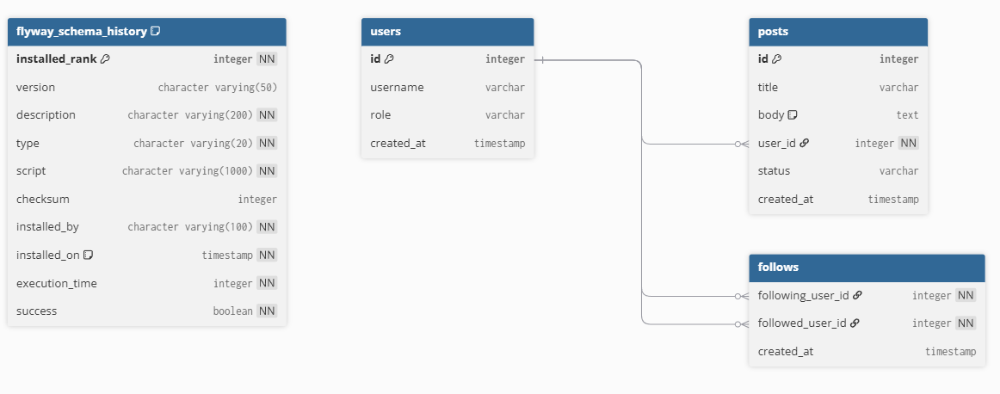
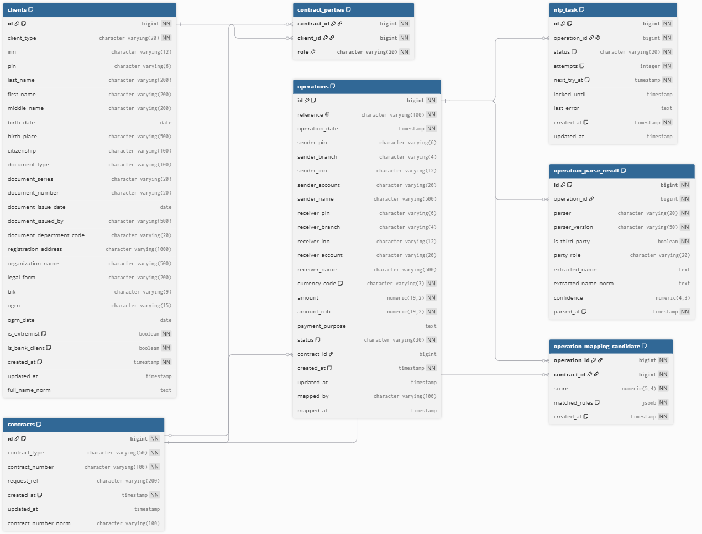

# Схема базы данных

PostgreSQL 16. Схема управляется миграциями Flyway
(`backend/src/main/resources/db/migration/`), применяются автоматически
при старте приложения.

## Миграции

| Миграция | Что делает |
|---|---|
| `V1__init_schema.sql` | Базовые таблицы `clients`, `contracts`, `operations` и индексы |
| `V2__mapping_schema.sql` | Схема маппинга: `contract_parties`, `operation_parse_result`, `operation_mapping_candidate`, `nlp_task`; нормализация, последовательности, индексы |
| `V3__add_beneficiary_classification_columns.sql` | `operation_parse_result`: `classification_method`, `classification_score`, `is_genuine_third_party` |
| `V4__mapping_pipeline.sql` | Статус `PARSED`, `operations.mapping_reason`, индекс `idx_operation_parsed` |
| `V5__drop_duplicate_extracted_beneficiary_name_column.sql` | Удалён дублирующий столбец из V3 |
| — | `V6` пропущена, номер не использовался |
| `V7__nlp_settings.sql` | `nlp_settings` + `nlp_settings_history`, дефолтные настройки |
| `V8__app_user.sql` | `app_user`: пользователи и роли |
| `V9__nlp_task_open_index.sql` | Индекс `idx_nlp_task_open` по открытым задачам очереди |

## Таблицы

| Таблица | Назначение | Ключевые поля |
|---|---|---|
| `clients` | Клиенты банка (ФЛ, ИП, ЮЛ в одной таблице) | `inn` (nullable), `client_type`, `full_name_norm`, `is_bank_client` |
| `contracts` | Договоры | `contract_number`, `contract_number_norm`, `contract_type` |
| `contract_parties` | Стороны договора в ролях `COUNTERPARTY` / `AGENT` / `BENEFICIARY`; PK `(contract_id, role, client_id)` | `contract_id`, `client_id`, `role` |
| `operations` | Операции (платежи) из АБС | `reference`, `sender_inn`, `receiver_inn`, `contract_id`, `status`, `mapped_by`, `mapping_reason` |
| `operation_parse_result` | Результаты парсинга назначения платежа (маркерный и NLP) | `operation_id`, `parser`, `extracted_name_norm`, `party_role`, `confidence`, `classification_method`, `classification_score`, `is_genuine_third_party` |
| `operation_mapping_candidate` | Договоры-кандидаты для операции со скорингом; PK `(operation_id, contract_id)` | `operation_id`, `contract_id`, `score`, `matched_rules` (JSONB) |
| `nlp_task` | Очередь задач на NLP-разбор; `operation_id` UNIQUE | `operation_id`, `status`, `attempts`, `next_try_at`, `locked_until`, `last_error` |
| `nlp_settings` | Действующие настройки NLP-классификатора, одна строка (`CHECK (id = 1)`) | `version`, `threshold`, `trigger_words`, `negation_words` |
| `nlp_settings_history` | История версий настроек (для отката) | `version` (PK), те же параметры, `changed_by`, `comment` |
| `app_user` | Пользователи приложения (HTTP Basic) | `username` (уникален в `lower()`), `password_hash` (BCrypt), `role` (`ADMIN`/`EDITOR`/`READER`), `enabled` |
| `flyway_schema_history` | Служебная таблица миграций | - |

## Статусы

`operations.status` (CHECK из V4) — конвейер обработки:

```
PENDING → WAITING_NLP → PARSED → AUTO_MAPPED | AMBIGUOUS | NOT_FOUND | MANUAL_REQUIRED
```

`operations.mapping_reason` — причина решения маппинга: `CONFIDENT_MATCH`,
`SINGLE_CANDIDATE`, `CLOSE_CANDIDATES`, `WEAK_EVIDENCE`,
`THIRD_PARTY_UNCONFIRMED`, `PARSE_UNAVAILABLE`, `NO_CANDIDATES`
(правила — в [mapping.md](mapping.md)).

`nlp_task.status` (CHECK): `NEW`, `IN_PROGRESS`, `DONE`, `FAILED`.

`operation_parse_result.classification_method` (CHECK): `MARKER`, `SEMANTIC`, `NLP_NER`.

## Связи

- `contract_parties.contract_id → contracts.id`, `contract_parties.client_id → clients.id` — стороны договора;
  у договора может быть несколько сторон одной роли
- `operations.contract_id → contracts.id` — итоговый привязанный договор (nullable, заполняется модулем маппинга)
- `operation_parse_result.operation_id`, `operation_mapping_candidate.operation_id`, `nlp_task.operation_id → operations.id`
- `operation_mapping_candidate.contract_id → contracts.id`

## Нормализация для поиска

Вычисляются в БД (generated columns), в Java только читаются:

- `clients.full_name_norm` — фамилия имя отчество в нижнем регистре, `ё → е`, одиночные пробелы.
  По тому же правилу считается `operation_parse_result.extracted_name_norm`,
  поэтому ФИО из парсера сравнивается с клиентом простым равенством
- `contracts.contract_number_norm` — только буквы и цифры, верхний регистр, `Ё → Е`
  (`№ 110-кр` → `110КР`)

## Индексы для маппинга

Маппинг ищет в `clients` и `contract_parties`, а не в `operations`:

- `clients`: `idx_client_inn (inn)`, `idx_client_full_name_norm (full_name_norm)`
- `contract_parties`: `idx_contract_party_client (client_id, role, contract_id)` — все договоры клиента одним индексным поиском
- `contracts`: `idx_contract_number_norm (contract_number_norm)`
- `operations`: частичные индексы по `id` — `idx_operation_pending` (для `PENDING`) и `idx_operation_parsed` (для `PARSED`): выборка пачками
- `nlp_task`: частичные индексы `idx_nlp_task_ready` (`NEW`), `idx_nlp_task_locked` (`IN_PROGRESS`), `idx_nlp_task_open` (`NEW` + `IN_PROGRESS`, V9)
- `app_user`: уникальный `uq_app_user_username (lower(username))`

## Диаграммы



