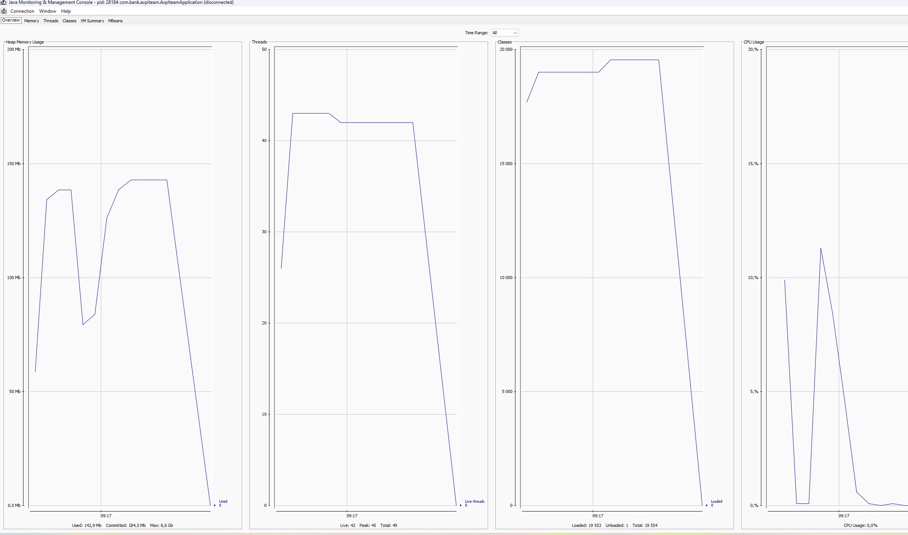
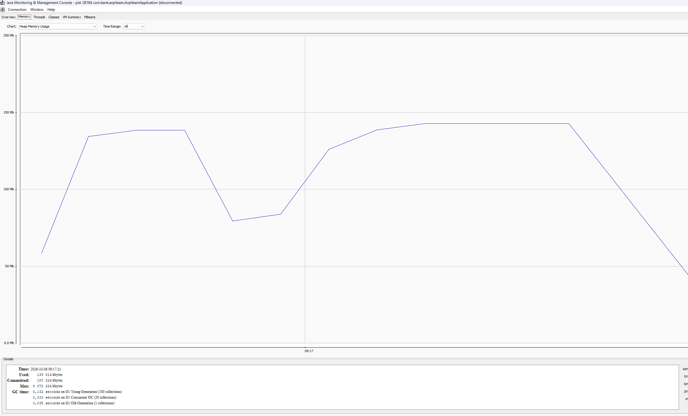

# Сравнение гипотез парсинга назначения платежа

## Методология

Классификация "платёж через третье лицо / обычный платёж" реализована
одинаково в обеих гипотезах - поиск маркерных слов и фраз в тексте.
Это сделано осознанно: классификация по бизнес-терминам не является
NLP-задачей, и разница в подходах должна проявляться именно в
извлечении сущности (ФИО выгодоприобретателя), а не в этом шаге.

Логика выбора кандидата на роль ФИО также унифицирована между Java
и Python-реализацией: при наличии нескольких найденных имён в тексте
выбирается ближайшее по позиции к найденному маркеру. Без этого
сравнение было бы нечестным - разная логика выбора кандидата
исказила бы результат сильнее, чем разница в самих библиотеках.

Датасет: 100 размеченных строк (50 платежей через третье лицо,
50 обычных платежей), включая мусорные строки и специально
подобранные падежные формы.

## Результаты

| Метрика                          | Гипотеза А (regex) | Гипотеза Б (NLP/Natasha) |
|-----------------------------------|---------------------|----------------------------|
| Точность классификации            | 100%                | 100%                       |
| Точность извлечения ФИО           | 30.0%               | 68.0%                      |
| Throughput (in-process)           | 573 000 ops/sec     | 973 ops/sec                |
| Время на 100k операций (1 поток)  | ~0.17 сек           | ~103 сек                   |
| CPU при нагрузке                  | 11.4%               | 235.7% (многоядерно)       |
| Память (дельта во время теста)    | +97 МБ (heap)       | +1.48 МБ (RSS)             |

Графики для гипотезы А:

## Найденные и исправленные ошибки (в рамках этой недели)

1. Маркер "третье лицо" искался как точная фраза и не ловил падежные
   формы ("для третьего лица"). Исправлено на поиск по корню слова
   в обеих реализациях.
2. NER/regex иногда захватывали служебное слово перед именем
   ("Выгодоприобретатель И.И. Иванов") как часть ФИО. Добавлен
   фильтр стоп-слов в обеих реализациях.

## Известные ограничения (не устранены, задокументированы)

**Regex-подход не понимает падежи.** Если ФИО
указано не в именительном падеже ("удержано из зарплаты Калашникова
Степана Ивановича"), подход не может сопоставить это с эталонной
формой без собственной морфологической логики - а её написание
фактически превратило бы простой алгоритм в упрощённую копию NLP-
подхода.

**NLP-подход (Natasha) имеет три специфичных паттерна ошибок:**

- *Усечение составного ФИО* (9 случаев из 50) - при нормализации
  падежной формы библиотека иногда сохраняет только фамилию,
  теряя имя и отчество.
- *Неполное согласование* (3 случая) - спан нормализуется
  потокенно, а не как единое целое, из-за чего отдельные слова
  остаются в исходном падеже.
- *Неоднозначность рода фамилии без контекста* - например,
  "Смирнова" грамматически может быть и женской фамилией в
  именительном падеже, и мужской в родительном. Без явного
  согласования с именем/отчеством библиотека выбирает статистически
  более вероятный вариант, что не всегда верно.

По нашей оценке, доработка постобработки (принудительное согласование
рода по имени, а не по фамилии; и другие методы) может
поднять точность извлечения с 68% до 80%+. Это не выполнено в рамках
данной недели сознательно - задача недели была оценить качество
подхода "из коробки", а не построить собственный морфологический слой
поверх готовой библиотеки.

## Предложения по архитектуре

Реализовать гибридную схему:

1. Маркерная классификация выполняется синхронно для каждой операции
   (643k+ ops/sec, нагрузка пренебрежимо мала).
2. Операции, классифицированные как "третье лицо", направляются в
   фоновую очередь на обработку NLP-сервисом.
3. NLP-сервис обрабатывает только отфильтрованное подмножество,
   а не весь поток операций - это кратно снижает реальную нагрузку
   по сравнению с оценкой "весь объём через NLP".

Даже без этой оптимизации (весь объём через NLP) один поток
обрабатывает 100 тысяч операций примерно за 1.7 минуты - технической
невозможности для синхронной обработки нет, но архитектурно
правильнее не завязывать отклик пользователю на внешний процесс
и учитывать особенности GIL в Python при масштабировании.