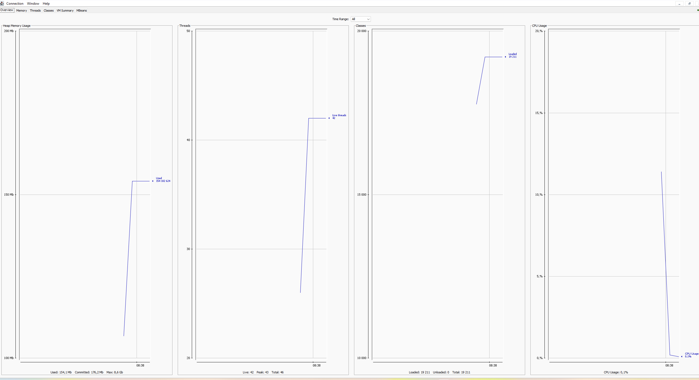
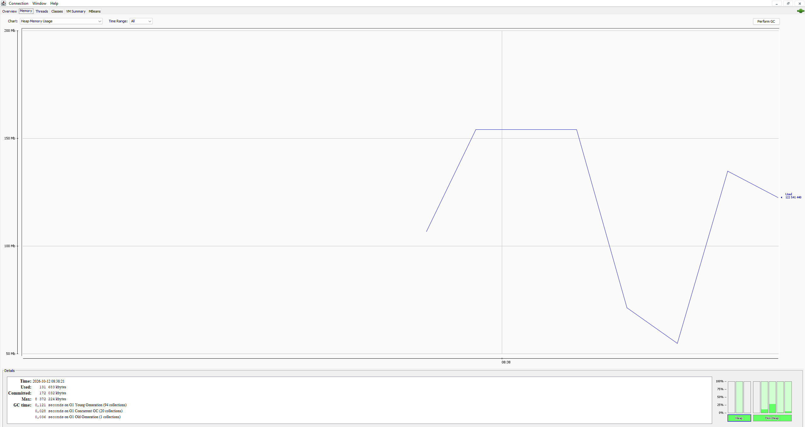

# Сравнение гипотез парсинга назначения платежа

## Методология

Классификация "платёж через третье лицо / обычный платёж" в
Гипотезах А и Б реализована идентично - через список маркерных
слов. Это сделано осознанно: на старте мы считали, что определение
типа платежа - не NLP-задача, а разница в подходах должна
проявляться только на этапе извлечения сущности (ФИО
выгодоприобретателя).

Логика выбора кандидата на роль ФИО унифицирована между Java и
Python-реализацией - при нескольких найденных именах в тексте
выбирается ближайшее к маркеру, не первое по тексту.

Для проверки устойчивости результатов собраны два датасета:
- **Основной** (100 строк) - целенаправленно покрывает падежные
  формы, мусорные строки, конструкции с неоднозначной ролью.
- **Holdout** (15 строк) - написан намеренно другой лексикой,
  не пересекающейся со списком реализованных маркеров. Цель -
  проверить, насколько подходы обобщаются за пределы собственного
  словаря, а не просто воспроизводят его

**Статистическая оговорка:** holdout состоит из 15 строк. При таком
объёме доверительный интервал для любой метрики широкий - например,
14/15 (93.3%) и 13/15 (86.7%) отличаются всего на один пример.
Абсолютные числа в этом разделе следует воспринимать как
качественный, направленный результат, а не как точную метрику
для принятия финальных решений. Подтверждение на большем объёме
данных - обязательный следующий шаг

## Результаты: извлечение ФИО (Гипотезы А и Б)

| Метрика | Гипотеза А (regex) | Гипотеза Б (NLP/Natasha) |
|---|---|---|
| Точность классификации (основной датасет) | 100% | 100% |
| Точность классификации (holdout) | 40% | 40% |
| Precision / Recall / F1 (holdout) | 60% / 30% / 40% | 60% / 30% / 40% |
| Точность извлечения ФИО (основной датасет) | 37.8% | 64.9% |
| Точность извлечения ФИО (holdout) | 14.3% | 14.3% |
| Throughput (in-process) | 573 000 ops/sec | 973 ops/sec |

## Графики для гипотезы А:

## Критическая находка: предел маркерного подхода к классификации

Проверка на holdout-датасете вскрыла системную проблему, общую для
обеих гипотез: классификация "третье лицо/нет" реализована у обеих
через один и тот же список маркерных слов, и этот список не
обобщается на лексику, которая не была в него заложена явно

**Пропущенные (FN) конструкции:** "в интересах", "за счёт",
"правопреемнику", "цессионарий", "вместо контрагента",
"по доверенности", "третьей стороной"

**Найдены и исправлены два класса багов** в маркерной проверке:

1. Отсутствие границ слова при поиске отрицания - подстрока "не"
   ложно матчилась внутри не связанных по смыслу слов
   ("несовершеннолетнего", "исполнение"). Исправлено переходом на
   regex с `\b`.
2. Проверка отрицания только в окне ПЕРЕД маркером - пропускала
   конструкции вида "третьи лица **не** привлекались", где
   отрицание идёт после ключевой фразы. Исправлено проверкой окна
   с обеих сторон от найденного триггера

После исправления precision вырос до 60% (убраны ложные
срабатывания), recall остался на уровне 30% - **фикс устранил
ложные срабатывания, но не восполнил пропуски из-за незнакомой
лексики**, это были два разных по природе класса ошибок. Это
подтверждает основной вывод: точечные фиксы устраняют конкретные
баги, но не решают системное ограничение - список ключевых слов
принципиально конечен, а естественный язык - нет

## Гипотеза В (прототип): семантическая классификация

Разработан прототип классификации на основе косинусного сходства
embedding-векторов текста с набором эталонных положительных и
отрицательных примеров, вместо точного совпадения ключевых слов.
Переиспользует уже загруженную в составе Natasha embedding-модель
(`NewsEmbedding`), дополнительных моделей не требует.

| Итерация | Accuracy на holdout |
|---|---|
| Первый прототип (без отрицания/калибровки) | 86.7% (13/15) |
| + калибровка негативных примеров (ложный позитив на "моральный ущерб") | вскрыты 2 новых бага отрицания |
| + исправление поиска отрицания (границы слова + двустороннее окно) | **93.3% (14/15)** |

Семантический подход поймал все смысловые конструкции, пропущенные
маркерным списком: "в интересах", "за счёт", "правопреемнику",
"цессионарий", "по доверенности", "третьей стороной" - то есть
решил именно ту проблему, ради которой разрабатывался.

### Оставшийся непокрытый случай (задокументированное ограничение)

Один пример (`id=4`, "третьи лица **не** привлекались") по-прежнему
классифицируется неверно: отрицание находится в 34 символах от
триггерного слова, что превышает используемое окно проверки
(20 символов). Решение **не увеличивать окно** принято осознанно -
единственный известный пример недостаточен, чтобы подбирать
параметр под него: это создало бы риск переобучения под конкретный
тестовый случай без гарантии, что решение обобщится на реальные
данные, и могло бы снизить precision на других формулировках.
Корректное решение этого класса случаев, вероятно, требует разбора
синтаксической структуры предложения (где именно в нём находится
отрицаемый глагол), а не просто окна фиксированной длины - это
выходит за рамки прототипа данной недели.

### Статус и ограничения прототипа

- Проверен на 15 строках - выборка слишком мала для статистически
  надёжных выводов, нужна проверка на большем объёме
- Представление предложения - простое усреднение word-векторов,
  грубый метод; специализированные sentence-encoder модели
  потенциально дадут более качественный результат
- Порог сходства (0.5) подобран вручную, требует калибровки на
  большем датасете
- Обработка отрицания - эвристика на основе окна символов,
  не учитывает синтаксическую структуру предложения
- Необходима проверка на реальных (не синтетических) данных

## Рекомендация по архитектуре

Заменить входной фильтр гибридной схемы с маркерного поиска на
семантическую классификацию. Общая архитектура эшелонирования
сохраняется:

Операция -> Семантический фильтр (быстро, embedding)

|-→ НЕ третье лицо → обычный маппинг по ИНН

│-→ Третье лицо → очередь NLP → Natasha извлекает ФИО → кандидаты маппинга

Семантический фильтр не заменяет NLP-извлечение сущности - это два
разных шага с разными задачами: первый определяет сам факт "нужна
ли эта операция в принципе", второй - извлекает конкретное имя.

## Общий вывод недели

1. По извлечению ФИО (при условии, что классификация верна) -
   NLP-подход превосходит алгоритмический почти в 2 раза
   (64.9% против 37.8%)
2. Критическая системная находка - маркерный способ классификации,
   общий для обеих основных гипотез, не обобщается на
   непредусмотренную лексику (recall 30% на holdout)
3. Предложен и опробован третий подход - семантическая
   классификация - показавший существенно лучшее обобщение
   (93.3% против 40% на той же holdout-выборке), с одним
   задокументированным оставшимся ограничением
4. Ни один из подходов не идеален - решение осознанно не
   дотягивалось до 100% ценой переобучения под единственный
   тестовый пример
5. Для перехода от прототипа к продакшен-решению необходимы
   реальные обезличенные данные - синтетические
   тестовые данные исчерпали свою полезность для дальнейшей
   калибровки